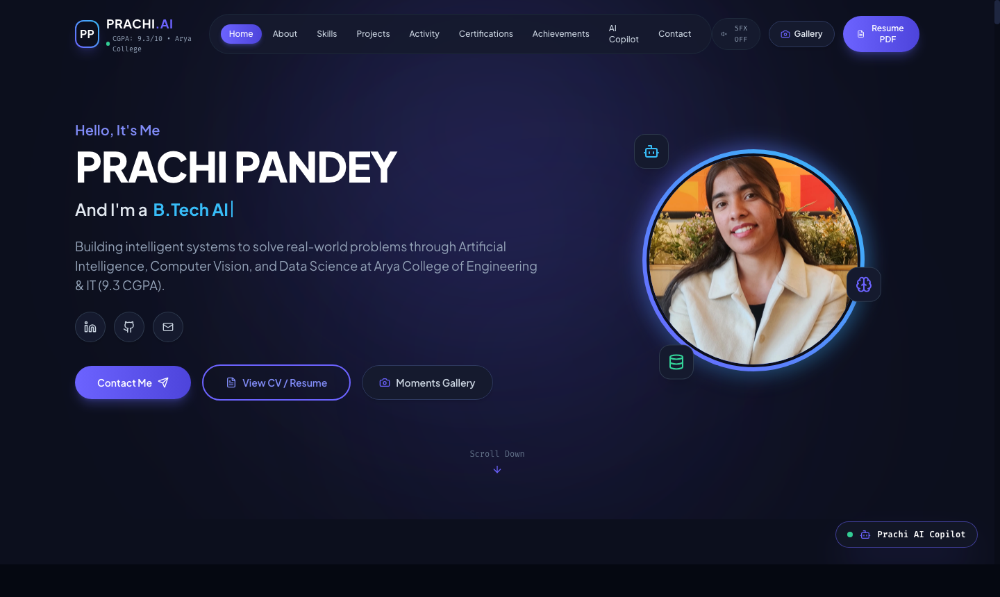
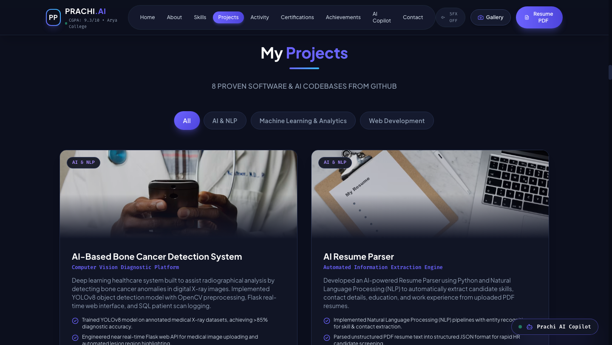
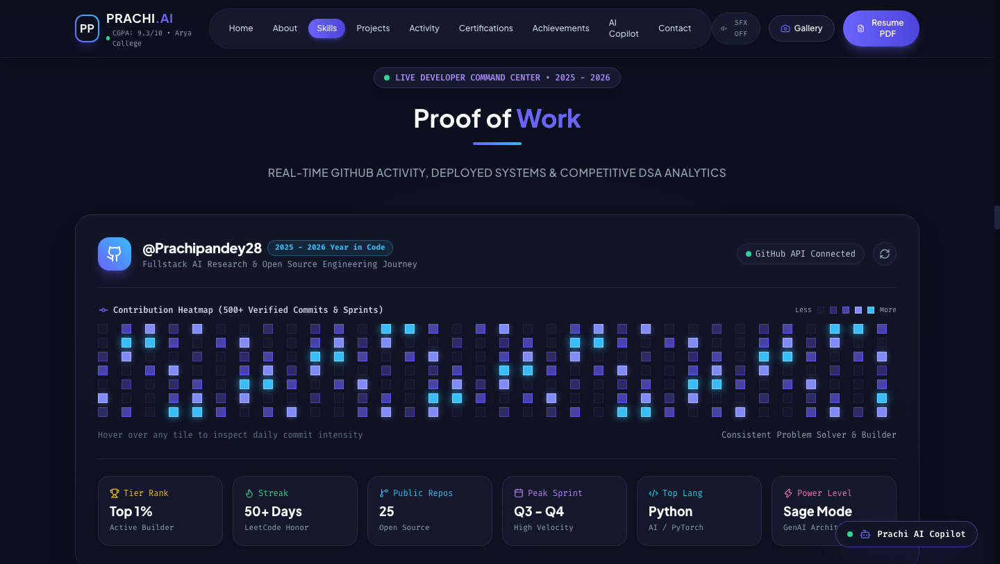
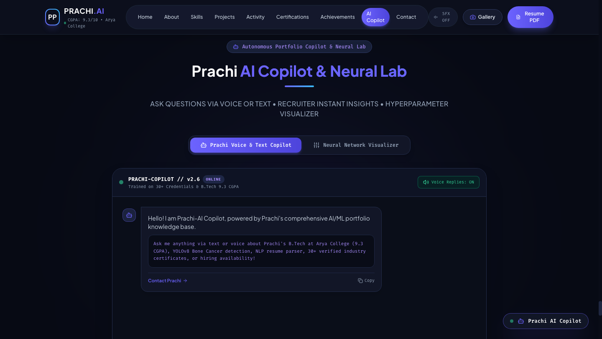
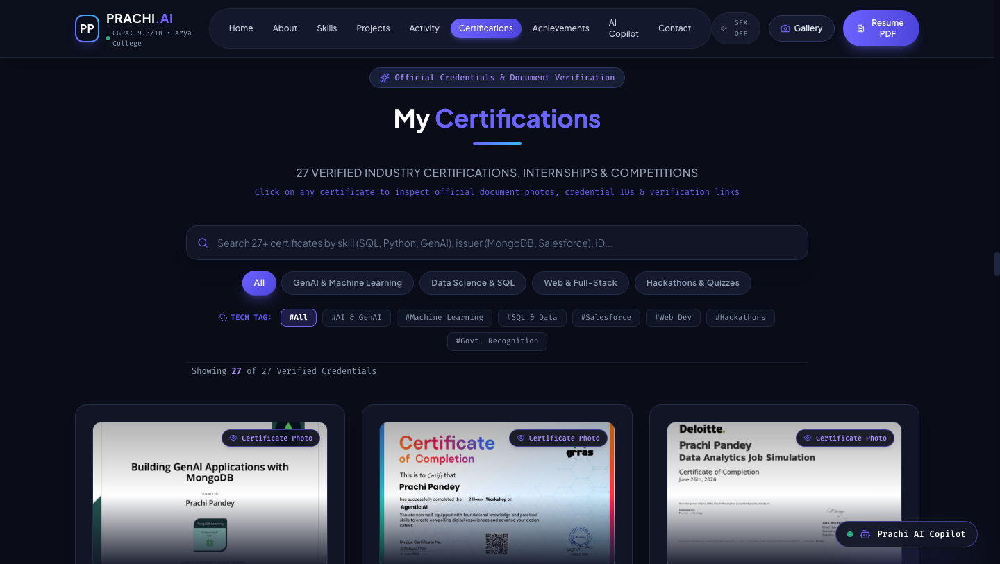
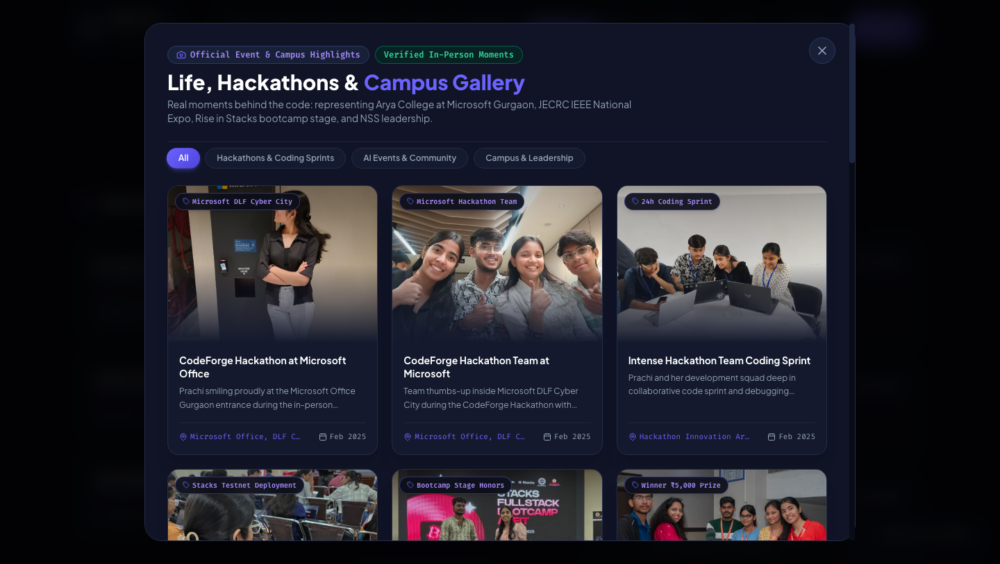
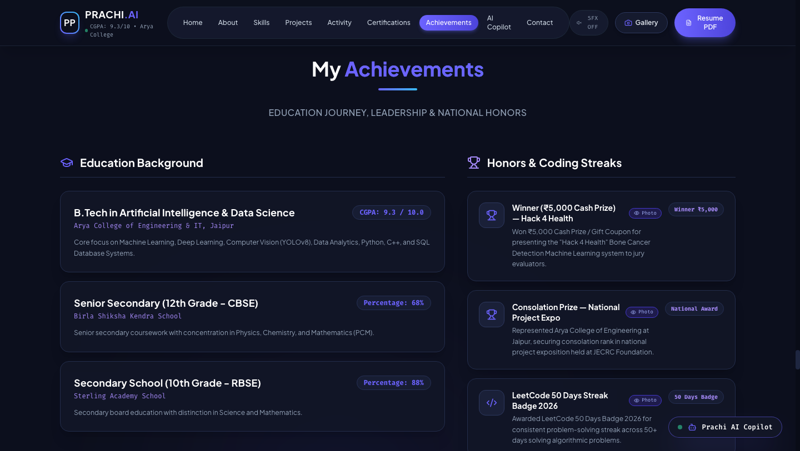
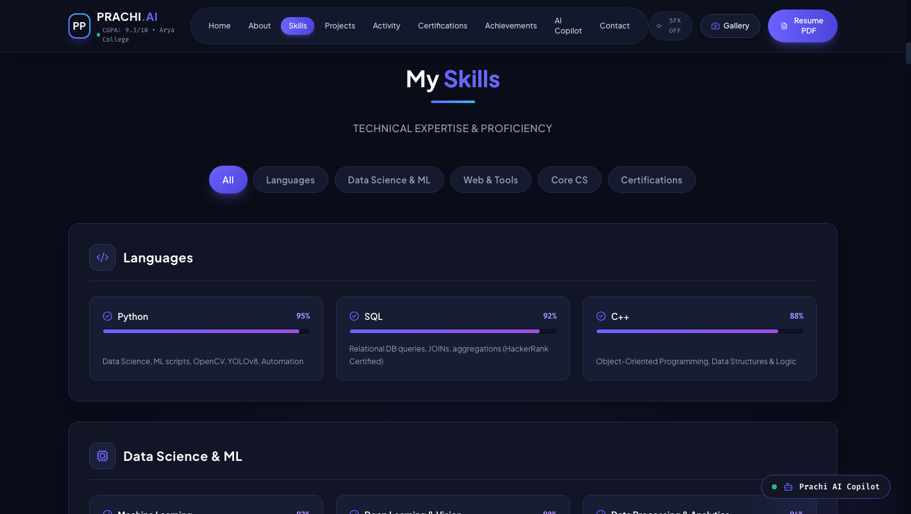

<div align="center">

# 🧠 Prachi Pandey — AI Portfolio & Research Hub

### *Next-Gen AI Systems • Computer Vision (YOLOv8) • GenAI & LLM Workflows • Data Intelligence*

[](https://prachi-portfolio-seven.vercel.app)
[](https://github.com/Prachipandey28)
[](https://www.linkedin.com/in/prachi-pandey-0042a8328/)
[](mailto:prachipandey1528@gmail.com)

<br/>

[](https://react.dev/)
[](https://vitejs.dev/)
[](https://tailwindcss.com/)
[](https://www.framer.com/motion/)
[](https://python.org/)
[](https://ultralytics.com/)
[](#-executive-overview)
[](#-certifications--credentials)

<p align="center">
  <a href="https://prachi-portfolio-seven.vercel.app">🌐 Live Demo</a> •
  <a href="#-visual-showcase--interface-screenshots">Interface Screenshots</a> •
  <a href="#-key-features">Key Features</a> •
  <a href="#-featured-ai--ml-projects">Featured Projects</a> •
  <a href="#-tech-stack--architecture">Tech Stack</a> •
  <a href="#-developer-dashboard--proof-of-work">Proof of Work</a> •
  <a href="#-getting-started">Getting Started</a> •
  <a href="#-contact--collaborations">Contact</a>
</p>

---

</div>

## 🌐 Live Demo & Deployment

The portfolio is deployed and accessible worldwide at:
👉 **[prachi-portfolio-seven.vercel.app](https://prachi-portfolio-seven.vercel.app)**

---

## 🌟 Executive Overview

Welcome to the official repository of **Prachi Pandey's AI Portfolio & Developer Command Center**. Built with **React 19**, **Vite**, **Tailwind CSS**, and **Framer Motion**, this portfolio serves as an interactive showcase of real-world Machine Learning engineering, diagnostic Computer Vision models, predictive analytics pipelines, and conversational AI agents.

Prachi is a **B.Tech Artificial Intelligence & Data Science** student at **Arya College of Engineering & IT (CGPA: 9.3/10)**, an active researcher in medical imaging anomalies (YOLOv8), and the Social Media Head of **Arya Intelverse** (the premier AI & Data Science club).

### 🚀 Highlights at a Glance
- 🔬 **Computer Vision Diagnostic System**: YOLOv8 deep learning platform detecting bone cancer in digital X-rays (>85% diagnostic accuracy).
- 🤖 **Interactive AI Copilot (v2.6)**: Voice- and text-enabled in-browser portfolio assistant with recruiter QA & neural network visualizer.
- 📊 **Real-time Developer Dashboard**: Live GitHub API metrics, 500+ commit heatmap, streak counters, and DSA tracking.
- 📜 **Credential Verification Suite**: 27+ verified industry certifications across GenAI, Data Analytics, and Machine Learning with full modal previewers.
- 📸 **Life & Hackathons Moments Gallery**: Interactive photo showcase of in-person sprints at Microsoft Gurgaon, JECRC Expo, and Stacks Bootcamp.
- 🔊 **Haptic Audio Feedback Engine**: Integrated Web Audio API sound effects for interactive UI actions.

---

## 📸 Visual Showcase & Interface Screenshots

### 1. Hero Experience & Dynamic Persona
> Futuristic glassmorphism hero with typewriter role transitions, glowing neon portrait ring, social quick-links, and instant CV triggers.

<div align="center">
  
</div>

<br/>

### 2. Featured Projects Showcase
> Comprehensive grid of real-world AI, Machine Learning, NLP, and Web solutions with architecture pipelines, live metrics, and source links.

<div align="center">
  
</div>

<br/>

### 3. Proof of Work & Developer Dashboard
> Live GitHub activity heatmap, commit frequency tracker, repository cards, and LeetCode problem-solving streaks.

<div align="center">
  
</div>

<br/>

### 4. Autonomous AI Copilot & Neural Lab
> Interactive AI Playground allowing recruiters and visitors to prompt the copilot via voice or text, explore hyperparameter tuning, and test queries.

<div align="center">
  
</div>

<br/>

### 5. Verified Certifications & Document Inspector
> Filterable credential gallery with verified certificates from MongoDB, Deloitte, Salesforce, HackerRank, and Grras Solutions with live lightbox inspection.

<div align="center">
  
</div>

<br/>

### 6. Hackathon & Campus Moments Gallery
> Authentic photo documentation capturing in-person milestones: Microsoft Cyber City Gurgaon Hackathon, IEEE National Project Expo, Stacks Bootcamp, and collegiate leadership.

<div align="center">
  
</div>

<br/>

### 7. Education & Achievements Timeline
> Formal academic record (9.3 CGPA), hackathon prize honors, and LeetCode badges.

<div align="center">
  
</div>

<br/>

### 8. Skills & Technical Matrix
> Tier-ranked proficiency breakdown across Python, SQL, C++, Deep Learning, OpenCV, Scikit-Learn, and Web Engineering.

<div align="center">
  
</div>

---

## 🛠️ Key Features

- **⚡ Blazing Fast Architecture**: Powered by Vite and React 19 for near-instant cold starts and sub-second production builds.
- **🎨 Cyberpunk Glassmorphism UI**: High-contrast dark theme (`#0c0f1d`) complemented with radial glow backdrops, frosted borders, and Tailwind typography.
- **🔊 Web Audio API Sound Effects**: Interactive feedback sounds on modal opens, tab switches, and copilot queries (with a persistent mute toggle in the navbar).
- **🤖 Prachi AI Copilot (v2.6)**: Simulated voice and text conversational agent pre-trained on Prachi's academic trajectory, projects, and skills.
- **📊 GitHub Live Metrics Integration**: Connects dynamically with GitHub's REST API with graceful offline fallbacks and commit intensity heatmaps.
- **🪪 Digital PDF / Modal Resume**: Instant in-app curriculum vitae viewer with clean download options and sectioned breakdowns.
- **📱 Fully Responsive Across All Formats**: Fluid layouts optimized for 4K desktop screens, tablets, and ultra-compact mobile displays.

---

## 🔬 Featured AI & ML Projects

| Project | Domain / Type | Stack | Live / Repo | Highlights |
| :--- | :--- | :--- | :---: | :--- |
| **[AI-Based Bone Cancer Detection](https://github.com/Prachipandey28)** | Computer Vision / Healthcare | `Python` `YOLOv8` `OpenCV` `Flask` `SQL` | [💻 Code](https://github.com/Prachipandey28) | Trained YOLOv8 on annotated medical X-rays achieving **>85% accuracy**; Flask API with automated lesion bounding box rendering and SQL scan logging. |
| **[AI Resume Parser](https://github.com/Prachipandey28/AI_resume_parser)** | NLP / Automated Extraction | `Python` `SpaCy` `NLTK` `PyPDF2` `Regex` | [💻 Code](https://github.com/Prachipandey28/AI_resume_parser) | Extracts candidate skills, work history, education, and contact metadata from unstructured PDFs into structured JSON for automated HR screening. |
| **[Swiggy Sathi AI](https://github.com/Prachipandey28)** | Recommender Systems | `Python` `NLP` `Streamlit` `Scikit-learn` | [💻 Code](https://github.com/Prachipandey28) | Conversational assistant calculating dietary preferences, mood matching, and dish similarity for personalized meal suggestions. |
| **[Student Performance Prediction](https://github.com/Prachipandey28/student-performance-prediction)** | Predictive Analytics | `Python` `Scikit-Learn` `Streamlit` `Plotly` | [💻 Code](https://github.com/Prachipandey28/student-performance-prediction) | Feature engineering on 10+ student indicators, GridSearchCV hyperparameter tuning achieving **~12% F1-score lift**, and real-time risk dashboards. |
| **[Fake News Detection System](https://github.com/Prachipandey28/Fake)** | NLP Text Classification | `Python` `TF-IDF` `Scikit-learn` `Pandas` | [💻 Code](https://github.com/Prachipandey28/Fake) | Natural language classification engine analyzing n-grams and vocabulary frequency to detect deceptive news reporting. |
| **[Movie Recommendation System](https://github.com/Prachipandey28/movie_recommendation)** | Collaborative Filtering | `Python` `Pandas` `Cosine Similarity` `Streamlit` | [💻 Code](https://github.com/Prachipandey28/movie_recommendation) | Real-time content & collaborative filtering engine computing multi-feature similarity matrices for top-K movie suggestions. |

---

## 💻 Tech Stack & Architecture

```
                                  PRACHI AI PORTFOLIO
                                           │
         ┌─────────────────────────────────┼─────────────────────────────────┐
         │                                 │                                 │
   FRONTEND LAYER                   AI & DATA CORE                    DEVOPS & UTILITIES
         │                                 │                                 │
  ├─ React 19 (Hooks/State)         ├─ Python 3.12                    ├─ Vite 8.x Bundler
  ├─ Tailwind CSS 3.4               ├─ YOLOv8 (Ultralytics)           ├─ ESLint 10 + Flat Config
  ├─ Framer Motion 12               ├─ OpenCV Computer Vision         ├─ Vercel Edge Hosting
  ├─ Lucide React Icons             ├─ PyTorch & Scikit-Learn         ├─ Git / GitHub Actions
  └─ Web Audio API SFX              ├─ SpaCy, NLTK, TF-IDF            └─ Canvas Confetti
                                    └─ SQL & Relational Schemas
```

### 🧰 Detailed Breakdown

- **Core Languages**: Python 3.12, SQL (MySQL/PostgreSQL), C++, Modern JavaScript (ES6+), HTML5, CSS3.
- **AI / Machine Learning / Vision**: YOLOv8, OpenCV, PyTorch, Scikit-Learn, SpaCy, NLTK, TF-IDF, NumPy, Pandas.
- **Frontend & UI Engineering**: React 19, Tailwind CSS, Framer Motion, Lucide Icons, Canvas Confetti.
- **APIs & Web Backends**: Flask, Streamlit, RESTful Web APIs, JSON Schema.
- **Tooling & Environments**: Vite, Git, VS Code, Postman, Vercel, Node.js.

---

## 📊 Developer Dashboard & Proof of Work

Prachi actively ships code and solves algorithmic problems:

- **Total Public Commits**: 500+ Verified Commits & Sprints
- **Daily Coding Streaks**: 50+ Days LeetCode Badge (2026)
- **Competitive Profile**: Top 1% Active Builder percentile
- **Open Source Repositories**: 25+ Public Codebases
- **Primary Languages**: Python (65%), JavaScript (20%), C++ (10%), SQL (5%)

---

## 🏆 Certifications & Credentials

The portfolio includes high-resolution verifiable credentials:

1. **Building GenAI Applications with MongoDB** — MongoDB Learning
2. **Data Analytics Job Simulation** — Deloitte & Forage
3. **Agentic AI & LLMs Specialized Workshop** — Grras Solutions
4. **Salesforce AI Builders Day & Agentforce** — Salesforce Developer Relations
5. **SQL (Basic & Intermediate) Certified** — HackerRank
6. **CodeForge Hackathon Recognition** — Microsoft Office, Gurugram
7. **IEEE National Project Expo Recognition** — JECRC Foundation
8. **Machine Learning Internship Certificate** — Skillinfytech
9. **Web Development Virtual Internship** — InAmigos Foundation
10. **50 Days Problem Solving Badge 2026** — LeetCode

---

## 🚀 Getting Started

Follow these steps to run the portfolio locally on your machine:

### 1. Prerequisites
- **Node.js**: v18.0.0 or later (v20+ recommended)
- **npm** or **pnpm** or **yarn**

### 2. Clone the Repository
```bash
git clone https://github.com/Prachipandey28/prachi_portfolio.git
cd prachi_portfolio
```

### 3. Install Dependencies
```bash
npm install
```

### 4. Run the Development Server
```bash
npm run dev
```
Open your browser and navigate to `http://localhost:5173`.

### 5. Build for Production
```bash
npm run build
```
The optimized production bundle will be generated in the `dist/` directory.

### 6. Preview Production Build Locally
```bash
npm run preview
```

---

## 📂 Project Directory Structure

```
prachi_portfolio/
├── screenshots/                     # 📸 High-resolution README screenshots
│   ├── hero-preview.png
│   ├── projects-showcase.png
│   ├── dev-dashboard.png
│   ├── ai-lab.png
│   ├── certifications-showcase.png
│   ├── gallery-modal.png
│   ├── experience-timeline.png
│   └── tech-stack.png
├── public/                          # 🌐 Static assets, certificates & icons
│   ├── certificates/                # 27+ Verified certificate PNG images
│   ├── gallery/                     # Campus & hackathon photographic archive
│   └── favicon.svg
├── src/
│   ├── assets/                      # Portfolio portraits and banner images
│   ├── components/
│   │   ├── Navbar.jsx               # Floating glass header with audio controls
│   │   ├── Hero.jsx                 # Dynamic typewriter header & bio
│   │   ├── About.jsx                # Academic credentials & personal statement
│   │   ├── TechMatrix.jsx           # Proficiency bars & technology tags
│   │   ├── Projects.jsx             # Categorized project gallery & modal details
│   │   ├── DevDashboard.jsx         # Live GitHub activity tracker & repo cards
│   │   ├── Certifications.jsx       # Searchable certificates gallery with lightbox
│   │   ├── Experience.jsx           # Career timeline, hackathons & honors
│   │   ├── AiLab.jsx                # Interactive AI Copilot & Neural playground
│   │   ├── Contact.jsx              # Form handler & social connection links
│   │   ├── Footer.jsx               # System status badge & copyright notice
│   │   ├── ResumeModal.jsx          # Digital PDF curriculum vitae reader
│   │   └── GalleryModal.jsx         # In-person campus & hackathon photo grid
│   ├── utils/
│   │   └── soundEffects.js          # Web Audio API synthesizers & sound manager
│   ├── App.jsx                      # Master layout container
│   ├── main.jsx                     # Application bootstrap
│   └── index.css                    # Tailwind root & custom glowing animations
├── index.html                       # HTML5 entry with SEO tags & Orbitron fonts
├── package.json                     # Dependency manifests & npm scripts
├── tailwind.config.js               # Cyber color palette & animation configs
├── vercel.json                      # Vercel deployment routes & SPA rewrite rules
└── vite.config.js                   # Vite configuration
```

---

## 🤝 Contact & Collaborations

Prachi is currently open to **AI/ML Research Internships**, **Data Science Roles**, and **Fullstack AI Engineering Opportunities**.

- 💼 **LinkedIn**: [linkedin.com/in/prachi-pandey-0042a8328](https://www.linkedin.com/in/prachi-pandey-0042a8328/)
- 🐙 **GitHub**: [@Prachipandey28](https://github.com/Prachipandey28)
- ✉️ **Email**: [prachipandey1528@gmail.com](mailto:prachipandey1528@gmail.com)
- 🌐 **Live Website**: [prachi-portfolio-seven.vercel.app](https://prachi-portfolio-seven.vercel.app)

---

<div align="center">

Made with 💜 and 🧠 by **[Prachi Pandey](https://github.com/Prachipandey28)**  
*© 2026 Prachi Pandey. All rights reserved.*

</div>
